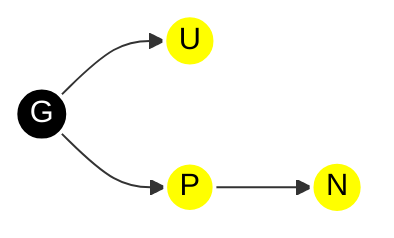

# 数据结构

## 数组


## 链表


## 树


### AVL

```java
import java.util.LinkedList;
import java.util.Queue;

public class AVLTree<K extends Comparable<K>, V> {
    private Node root;

    private class Node {
        K key;
        V val;
        int height;
        Node left, right;

        Node(K key, V val) {
            this.key = key;
            this.val = val;
            this.height = 1;
        }
    }

    // 高度工具
    private int height(Node n) { return n == null ? 0 : n.height; }

    // 更新节点高度
    private void updateHeight(Node n) {
        if (n != null)
            n.height = 1 + Math.max(height(n.left), height(n.right));
    }

    // 平衡因子：左高 - 右高
    private int balanceFactor(Node n) {
        return n == null ? 0 : height(n.left) - height(n.right);
    }

    // 右旋（LL情况）
    private Node rotateRight(Node y) {
        Node x = y.left;
        Node T2 = x.right;
        x.right = y;
        y.left = T2;
        updateHeight(y);
        updateHeight(x);
        return x;
    }

    // 左旋（RR情况）
    private Node rotateLeft(Node x) {
        Node y = x.right;
        Node T2 = y.left;
        y.left = x;
        x.right = T2;
        updateHeight(x);
        updateHeight(y);
        return y;
    }

    // 插入
    public void put(K key, V val) {
        root = put(root, key, val);
    }

    private Node put(Node node, K key, V val) {
        if (node == null) return new Node(key, val);
        int cmp = key.compareTo(node.key);
        if (cmp < 0) node.left = put(node.left, key, val);
        else if (cmp > 0) node.right = put(node.right, key, val);
        else { node.val = val; return node; } // 更新值

        updateHeight(node);
        int balance = balanceFactor(node);

        // 左左（LL）
        if (balance > 1 && key.compareTo(node.left.key) < 0)
            return rotateRight(node);
        // 右右（RR）
        if (balance < -1 && key.compareTo(node.right.key) > 0)
            return rotateLeft(node);
        // 左右（LR）
        if (balance > 1 && key.compareTo(node.left.key) > 0) {
            node.left = rotateLeft(node.left);
            return rotateRight(node);
        }
        // 右左（RL）
        if (balance < -1 && key.compareTo(node.right.key) < 0) {
            node.right = rotateRight(node.right);
            return rotateLeft(node);
        }
        return node;
    }

    // 查找最小值节点
    private Node min(Node node) {
        while (node.left != null) node = node.left;
        return node;
    }

    // 删除
    public void delete(K key) {
        root = delete(root, key);
    }

    private Node delete(Node node, K key) {
        if (node == null) return null;
        int cmp = key.compareTo(node.key);
        if (cmp < 0) node.left = delete(node.left, key);
        else if (cmp > 0) node.right = delete(node.right, key);
        else {
            // 找到待删除节点
            if (node.left == null) return node.right;
            if (node.right == null) return node.left;
            // 有两个孩子：用后继（中序最小）替代
            Node successor = min(node.right);
            node.key = successor.key;
            node.val = successor.val;
            node.right = delete(node.right, successor.key);
        }

        if (node == null) return null;
        updateHeight(node);
        int balance = balanceFactor(node);

        // 平衡修复（与插入类似）
        // LL
        if (balance > 1 && balanceFactor(node.left) >= 0)
            return rotateRight(node);
        // LR
        if (balance > 1 && balanceFactor(node.left) < 0) {
            node.left = rotateLeft(node.left);
            return rotateRight(node);
        }
        // RR
        if (balance < -1 && balanceFactor(node.right) <= 0)
            return rotateLeft(node);
        // RL
        if (balance < -1 && balanceFactor(node.right) > 0) {
            node.right = rotateRight(node.right);
            return rotateLeft(node);
        }
        return node;
    }

    // 中序遍历（测试用）
    public void inorder() {
        inorder(root);
        System.out.println();
    }
    private void inorder(Node n) {
        if (n == null) return;
        inorder(n.left);
        System.out.print(n.key + " ");
        inorder(n.right);
    }

    public static void main(String[] args) {
        AVLTree<Integer, String> avl = new AVLTree<>();
        for (int i = 1; i <= 7; i++) avl.put(i, "v" + i);
        avl.inorder();  // 1 2 3 4 5 6 7
        avl.delete(4);
        avl.inorder();  // 1 2 3 5 6 7
    }
}
```


### 红黑树

Java的TreeMap、TreeSet

#### 红黑树五个性质

1. 每个节点要么是红色，要么是黑色
2. 根节点是黑色
3. 所有叶（NULL）节点是黑色
4. 如果一个节点是红色，那么它的左右子节点都是黑色
5. 从任意一个节点到其每个叶子的路径，都包含相同数量的黑色节点
6. 衍生特性：从根节点到叶子节点的最长路径（红黑相间），不超过最短路径（全黑）的2倍


#### 实现


```java
public class RedBlackTree<K extends Comparable<K>, V> {
    private static final boolean RED   = true;
    private static final boolean BLACK = false;

    private Node root;

    private class Node {
        K key;
        V val;
        Node left, right, parent;
        boolean color;

        Node(K key, V val, boolean color) {
            this.key = key;
            this.val = val;
            this.color = color;
            this.parent = null;
        }
    }

    // 辅助：判断节点颜色
    private boolean isRed(Node x) {
        return x != null && x.color == RED;
    }

    // 辅助：设置颜色
    private void setColor(Node x, boolean color) {
        if (x != null) x.color = color;
    }

    // 左旋（返回新根）
    private Node rotateLeft(Node x) {
        Node y = x.right;
        x.right = y.left;
        if (y.left != null) y.left.parent = x;
        y.parent = x.parent;
        if (x.parent == null) root = y;
        else if (x == x.parent.left) x.parent.left = y;
        else x.parent.right = y;
        y.left = x;
        x.parent = y;
        // 颜色不变（由调用者负责调整）
        return y;
    }

    // 右旋
    private Node rotateRight(Node x) {
        Node y = x.left;
        x.left = y.right;
        if (y.right != null) y.right.parent = x;
        y.parent = x.parent;
        if (x.parent == null) root = y;
        else if (x == x.parent.right) x.parent.right = y;
        else x.parent.left = y;
        y.right = x;
        x.parent = y;
        return y;
    }
}
```


##### 插入




| 情况    | 条件                                | 调整                                   |
| ------- | ----------------------------------- | -------------------------------------- |
| 0       | N是根节点                           | 将N染黑                                |
| 1       | U是红色，P是G的左孩子               | P/U染黑，G染红，current指向G           |
| 2       | U是红色，P是G的右孩子               | P/U染黑，G染红，current指向G           |
| 3(左左) | U是黑色，P是G的左孩子，N是P的左孩子 | P染黑，G染红，对G进行右旋              |
| 4(右右) | U是黑色，P是G的右孩子，N是P的右孩子 | P染黑，G染红，对G进行左旋              |
| 5(左右) | U是黑色，P是G的左孩子，N是P的右孩子 | 对P进行左旋，N染黑，G染红，对G进行右旋 |
| 6(右左) | U是黑色，P是G的右孩子，N是P的左孩子 | 对P进行右旋，N染黑，G染红，对G进行左旋 |


```java
public class RedBlackTree<K extends Comparable<K>, V> {
    // 为了简便，提供一个统一的 put 方法（迭代插入 + 修复）
    // 插入会打破性质2、4
    public void put2(K key, V val) {
        Node z = new Node(key, val, RED);
        insertNode(z);
        fixInsertion(z);
        root.color = BLACK;
    }

    private void insertNode(Node z) {
        Node y = null;
        Node x = root;
        while (x != null) {
            y = x;
            int cmp = z.key.compareTo(x.key);
            if (cmp < 0) x = x.left;
            else if (cmp > 0) x = x.right;
            else {
                // 更新值
                x.val = z.val;
                return;
            }
        }
        z.parent = y;
        if (y == null) {
            root = z;
        } else if (z.key.compareTo(y.key) < 0) {
            y.left = z;
        } else {
            y.right = z;
        }
        // 左右孩子默认 null
    }

    // 插入修复（标准红黑树 case 分析）
    private void fixInsertion(Node z) {
        while (isRed(z.parent)) { // 父节点为红，需要修复
            if (z.parent == z.parent.parent.left) {
                // 父节点是左孩子
                Node y = z.parent.parent.right; // 叔叔
                if (isRed(y)) { // case 1: 叔叔为红
                    z.parent.color = BLACK;
                    z.parent.parent.color = RED;
                    y.color = BLACK;
                    z = z.parent.parent;
                } else {
                    // 叔叔为黑
                    if (z == z.parent.right) { // case 2: z 是右孩子
                        z = z.parent;
                        rotateLeft(z);
                    }
                    // case 3: z 是左孩子
                    z.parent.color = BLACK;
                    z.parent.parent.color = RED;
                    rotateRight(z.parent.parent);
                }
            } else { // 父节点是右孩子，对称
                Node y = z.parent.parent.left; // 叔叔
                if (isRed(y)) {
                    z.parent.color = BLACK;
                    z.parent.parent.color = RED;
                    y.color = BLACK;
                    z = z.parent.parent;
                } else {
                    if (z == z.parent.left) { // case 2 对称
                        z = z.parent;
                        rotateRight(z);
                    }
                    z.parent.color = BLACK;
                    z.parent.parent.color = RED;
                    rotateLeft(z.parent.parent);
                }
            }
        }
        root.color = BLACK;
    }
}
```


##### 删除

红色节点可以直接删除


```java
public class RedBlackTree<K extends Comparable<K>, V> {
    // 删除
    public void delete(K key) {
        Node z = findNode(key);
        if (z == null) return;
        deleteNode(z);
        if (root != null) root.color = BLACK;
    }

    private Node findNode(K key) {
        Node x = root;
        while (x != null) {
            int cmp = key.compareTo(x.key);
            if (cmp < 0) x = x.left;
            else if (cmp > 0) x = x.right;
            else return x;
        }
        return null;
    }

    private void deleteNode(Node z) {
        Node x;
        Node y = z;
        boolean yOriginalColor = y.color;
        if (z.left == null) {
            // 只有右孩子或无孩子
            x = z.right;
            transplant(z, z.right);
        } else if (z.right == null) {
            x = z.left;
            transplant(z, z.left);
        } else {
            // 有两个孩子，找后继
            y = minimum(z.right);
            yOriginalColor = y.color;
            x = y.right;
            if (y.parent == z) {
                if (x != null) x.parent = y;
            } else {
                transplant(y, y.right); // 后继节点取出来
                y.right = z.right;		// 被删除节点右孩子的父亲修改为后继节点
                y.right.parent = y;
            }
            transplant(z, y); // 后继节点替换被删除节点
            y.left = z.left;
            y.left.parent = y;
            y.color = z.color;
        }
        if (yOriginalColor == BLACK) {
            fixDeletion(x, y.parent);
        }
    }

    // 将 v 替换 u 的位置
    private void transplant(Node u, Node v) {
        if (u.parent == null) {
            root = v;
        } else if (u == u.parent.left) {
            u.parent.left = v;
        } else {
            u.parent.right = v;
        }
        if (v != null) {
            v.parent = u.parent;
        }
    }

    private Node minimum(Node x) {
        while (x.left != null) x = x.left;
        return x;
    }

    // 删除修复（标准红黑树 case 分析）
    private void fixDeletion(Node x, Node parent) {
        Node w;
        while (x != root && !isRed(x)) {
            if (x == parent.left) {
                w = parent.right;
                if (isRed(w)) { // case 1: 兄弟为红
                    w.color = BLACK;
                    parent.color = RED;
                    rotateLeft(parent);
                    w = parent.right;
                }
                if (!isRed(w.left) && !isRed(w.right)) { // case 2: 兄弟的孩子全黑
                    w.color = RED;
                    x = parent;
                    parent = x.parent;
                } else {
                    if (!isRed(w.right)) { // case 3: 兄弟左红右黑
                        w.left.color = BLACK;
                        w.color = RED;
                        rotateRight(w);
                        w = parent.right;
                    }
                    // case 4: 兄弟右红
                    w.color = parent.color;
                    parent.color = BLACK;
                    w.right.color = BLACK;
                    rotateLeft(parent);
                    x = root; // 终止
                }
            } else { // 对称
                w = parent.left;
                if (isRed(w)) {
                    w.color = BLACK;
                    parent.color = RED;
                    rotateRight(parent);
                    w = parent.left;
                }
                if (!isRed(w.right) && !isRed(w.left)) {
                    w.color = RED;
                    x = parent;
                    parent = x.parent;
                } else {
                    if (!isRed(w.left)) {
                        w.right.color = BLACK;
                        w.color = RED;
                        rotateLeft(w);
                        w = parent.left;
                    }
                    w.color = parent.color;
                    parent.color = BLACK;
                    w.left.color = BLACK;
                    rotateRight(parent);
                    x = root;
                }
            }
        }
        if (x != null) x.color = BLACK;
    }
}
```


##### 测试

```java
public class RedBlackTree<K extends Comparable<K>, V> {
	// 中序遍历（测试）
    public void inorder() {
        inorder(root);
        System.out.println();
    }
    private void inorder(Node n) {
        if (n == null) return;
        inorder(n.left);
        System.out.print(n.key + "(" + (n.color ? "R" : "B") + ") ");
        inorder(n.right);
    }

    // 验证红黑性质（可选）
    public boolean isValid() {
        // 可添加检查
        return true;
    }

    // 测试
    public static void main(String[] args) {
        RedBlackTree<Integer, String> rb = new RedBlackTree<>();
        int[] keys = {5, 3, 7, 2, 4, 6, 8, 1, 9};
        for (int k : keys) rb.put2(k, "v" + k);
        rb.inorder();
        rb.delete(4);
        rb.inorder();
        rb.delete(1);
        rb.inorder();
    }
}
```


## 图

